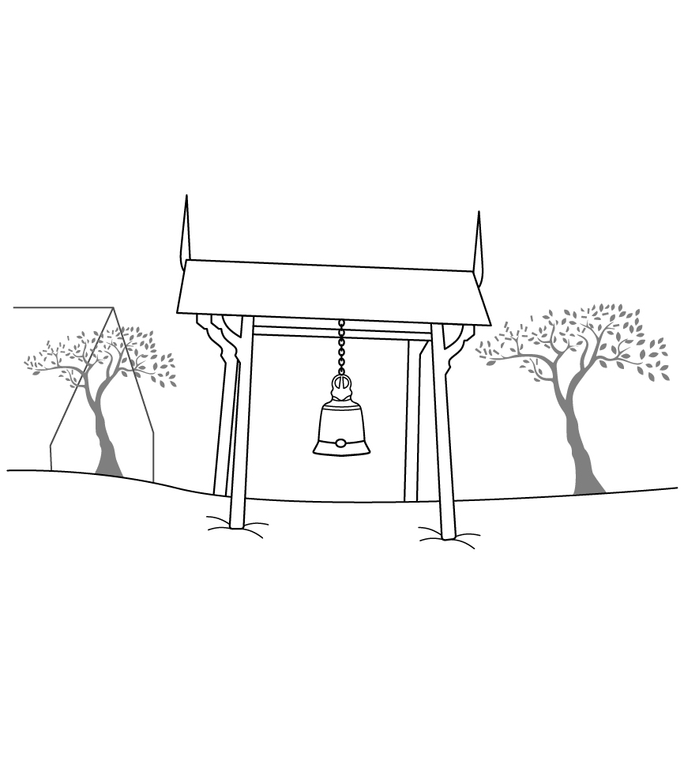
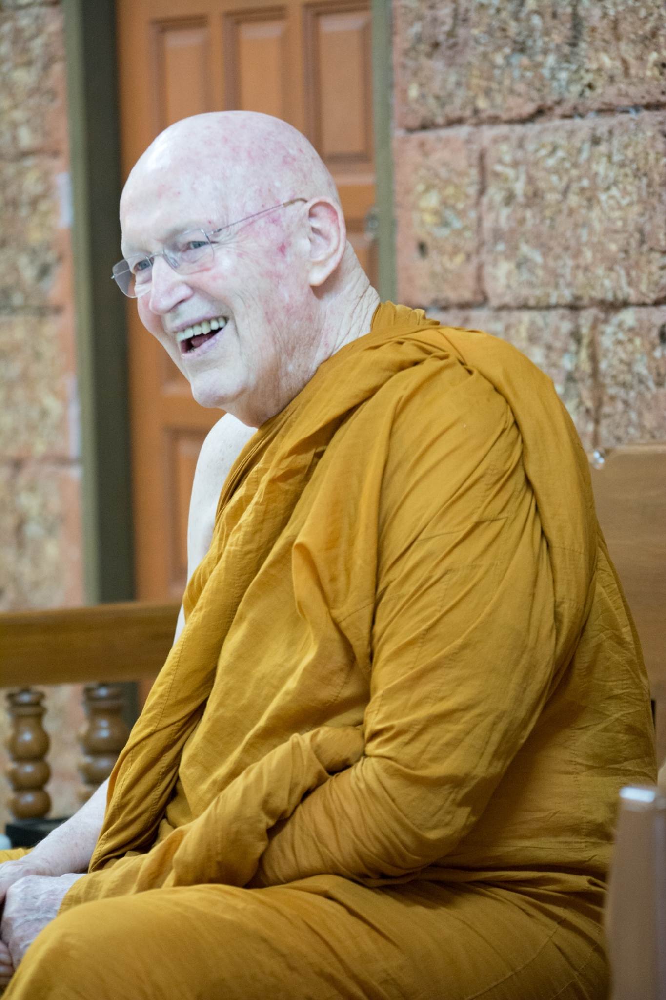

# สุขนั้นหรือยั่งยืน

> *แปลจากเรื่อง Happiness forever หนังสือ The way it is
> ธรรมบรรยาย ที่ประเทศสวิสเซอร์แลนด์ เดือนพฤษภาคม พ.ศ. 2526* 

พวกเราได้ฝึกสมาธิภาวนา เฝ้าดูลมหายใจ พิจารณาลมหายใจเข้า ลมหายใจออก
เราจะใช้ความใส่ใจแบบซื่อๆ ใช้สติระลึกรู้ร่างกายที่กำลังเดิน ยืน นั่ง นอน
และแทนที่จะปล่อยให้ใจหลงใหลตื่นตาไปตาม
เราจะเปิดใจรับรู้ต่อสภาวะทั้งหลายตามที่มันปรากฏอยู่ในปัจจุบันขณะ 

ให้สังเกตอาการว่า แม้กระทั่งในสถานที่ที่สวยงามขนาดนี้
เราก็ยังทำตัวเองให้เป็นทุกข์ขึ้นมาได้ เมื่อเรามาอยู่ที่นี่แล้ว
เราอาจจะอยากไปอยู่ที่อื่น เมื่อตอนที่เรากำลังเดิน
เราก็อยากจะนั่ง เมื่อเรากำลังนั่ง เรากลับรู้สึกอยากจะลุกไปเดิน
ขณะที่กำลังปฏิบัติสมาธิ เราก็ไปคิดเสียอีกว่าจะไปทำอะไรต่อดีนะ
หลังจากเสร็จจากการอบรมกรรมฐาน แต่พอเสร็จจากอบรมกรรมฐานไปแล้ว
เราก็ปรารถนาให้ตัวเองกลับมาอยู่ที่นี่\...มันน่าสิ้นหวังใช่ไหม 

ก่อนที่เราจะมาเข้าอบรมกรรมฐานครั้งนี้ เรากำลังมีปัญหาอยู่ทางบ้าน
และคอยแต่คิดว่า *"เมื่อไหร่จะได้ไปเข้าอบรมกรรมฐานสักที อดใจรอแทบไม่ไหวแล้ว"* แล้วพอมาอยู่ที่นี่เราก็คอยคิดว่า *"รอไม่ไหวแล้ว เมื่อไหร่จะอบรมกรรมฐานเสร็จเสียที"*
บางครั้งเราอาจจะนั่งได้อย่างสงบแล้วคิดว่า
*"อยากให้เป็นอย่างนี้ไปตลอดเลย"* หรือบางครั้ง
เราพยายามจะให้เกิดปีติสุขเหมือนเมื่อวาน
แต่กลับเป็นว่ายิ่งหงุดหงิดเข้าไปใหญ่ เมื่อเราได้สภาวะที่มีปีติสุข
เรากลับไปนึกถึงเรื่องกินและสิ่งที่จะทำ แล้วเราก็รู้สึกแย่ที่ปีติสุขหายไป
หรืออาจจะไม่มีปีติสุขอะไรเลยก็ได้ มีแต่ความทรงจำที่ขมขื่น
และความโกรธความผิดหวังที่ประดังขึ้นมา คนอื่นๆ ทุกคน มีปีติสุข
เราเลยรู้สึกผิดหวัง เพราะดูเหมือนว่าแต่ละคนที่มาปฏิบัติ
จะได้อะไรจากการเข้าอบรมกรรมฐานครั้งนี้ มีแต่เราที่ไม่เห็นจะได้อะไรเลย 

นี่แหละเป็นวิธี ที่เราจะได้เริ่มต้นสังเกตว่าทุกอย่างมีการเปลี่ยนแปลง
เมื่อเป็นดังนี้ เราก็มีโอกาสที่จะสังเกตเห็นว่า
เราสร้างปัญหาหรือยึดติดกับความดี หรือสร้างเรื่องให้มันยุ่งยากซับซ้อน
จากสภาวะต่างๆ รอบด้านในแต่ละช่วงขณะได้อย่างไร
คือเราจะอยากได้ในสิ่งที่ไม่มีบ้าง หวงแหนรักษาสิ่งที่มีอยู่แล้วบ้าง
อยากกำจัดทำลายสิ่งที่มีอยู่แล้วบ้าง
นี่แหละคือปัญหาเรื่องความอยากของมนุษย์เรา
เรามัวแต่จะแส่ส่ายหาเรื่องโน้นเรื่องนี้อยู่ตลอดเวลา 

อาตมาจำได้ว่า เมื่อตอนที่ยังเป็นเด็ก
แล้วอยากได้ของเล่นอยู่อย่างหนึ่ง อาตมารับปากกับโยมแม่ว่า
ถ้าโยมแม่ให้ของเล่นชิ้นนั้นกับอาตมาแล้ว
อาตมาจะไม่อยากได้อะไรอีกเลยตลอดไป
ของเล่นชิ้นนั้นต้องให้ความสุขกับอาตมาอย่างเต็มที่แน่
อาตมามั่นใจอย่างนั้น อาตมาเองก็ไม่ได้โกหกโยมแม่ด้วย
เพราะสิ่งเดียวที่ขัดขวางไม่ให้อาตมามีความสุขในตอนนั้น
ก็คือการที่อาตมาไม่มีของเล่นที่อยากได้ ในที่สุด
โยมแม่ก็ซื้อของเล่นมาให้อาตมา
อาตมามีความสุขอยู่กับของเล่นอันใหม่ได้เพียงแค่ห้านาทีเท่านั้น ต่อจากนั้น
อาตมาเริ่มรู้สึกอยากได้ของอย่างอื่นอีก 

ดังนั้น เมื่ออาตมาได้สิ่งที่ต้องการ
อาตมาก็รู้สึกพึงพอใจและมีความสุขอยู่หรอก แต่หลังจากนั้น
ความต้องการอย่างอื่นก็โผล่ตามมา อาตมายังคงจำเรื่องนี้ได้อย่างชัดเจน
เพราะตอนที่อยู่ในวัยเด็กขนาดนั้น อาตมาแน่ใจเหลือเกินว่า
ถ้าหากอาตมาได้ของเล่นที่อยากจะได้ อาตมาจะต้องมีความสุขตลอดไป แต่แล้ว
อาตมาต้องมาพบกับความจริงที่ว่า ความสุขตลอดไปนั้น
ไม่มีทางเป็นไปได้หรอก

