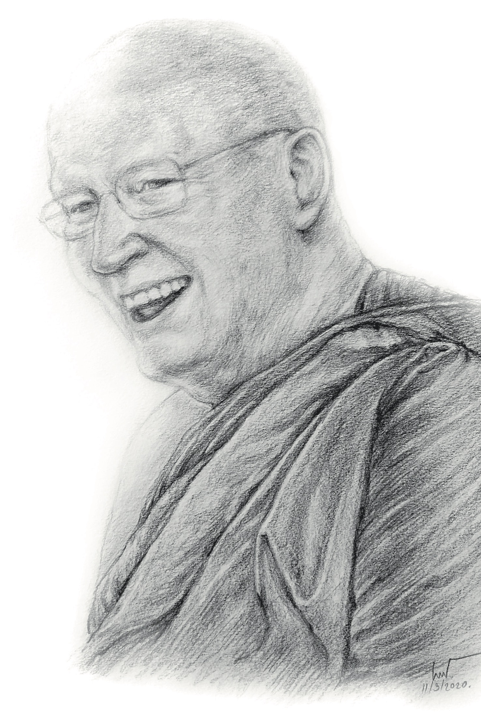

# คำนำ

หนังสือ หนึ่งลมหายใจ เล่มนี้ เป็นหนังสือรวมธรรมบรรยายแปล ๕ เรื่อง
โดยผู้แปลได้คัดแปลจากหนังสือ **The way it is**
ซึ่งเป็นหนังสือรวมธรรมบรรยายของหลวงพ่อสุเมโธ (สมณศักดิ์ในปัจจุบัน คือ
พระเทพญาณวิเทศ) ที่จัดพิมพ์ขึ้นเมื่อหลายสิบปีที่แล้ว
ขณะที่ท่านพำนักและปฏิบัติหน้าที่เป็นเจ้าอาวาส ที่วัดอมราวดี ประเทศอังกฤษ

หนังสือเล่มนี้ จัดพิมพ์ครั้งแรกเมื่อปี พ.ศ. ๒๕๕๖ จำนวน ๑๐,๐๐๐ เล่ม
โดยคณะสงฆ์วัดป่านานาชาติ เพื่อน้อมเป็นมุทิตาสักการะ
และเพื่อเป็นมงคลอนุสรณ์ ในมงคลโอกาสที่หลวงพ่อสุเมโธ เจริญอายุมงคลครบ ๗๙
ปี สำหรับการพิมพ์ครั้งที่ ๒ นี้ ผู้จัดทำได้จัดพิมพ์ขึ้นอีกวาระหนึ่ง
เพื่อแจกจ่ายเป็นธรรมบรรณาการแก่พุทธศาสนิกชนทั่วไป

ผู้จัดทำขออนุโมทนาขอบคุณทุกท่าน
ที่ช่วยให้การจัดพิมพ์หนังสือครั้งนี้สำเร็จลุล่วง
ไม่ว่าจะเป็นผู้บริจาคทุนทรัพย์ในการจัดพิมพ์
และผู้มีส่วนร่วมสนับสนุนด้านอื่นๆ
ขอผลแห่งการบำเพ็ญกุศลจริยาร่วมกันในครั้งนี้
จงเป็นปัจจัยให้ทุกท่านเป็นผู้ถึงพร้อมด้วยธรรมสมบัติและโภคสมบัติ
และจงเป็นปัจจัยแห่งสันติสุขแก่สรรพสัตว์ทั้งหลาย

ด้วยความปรารถนาดี

ผู้จัดทำ

